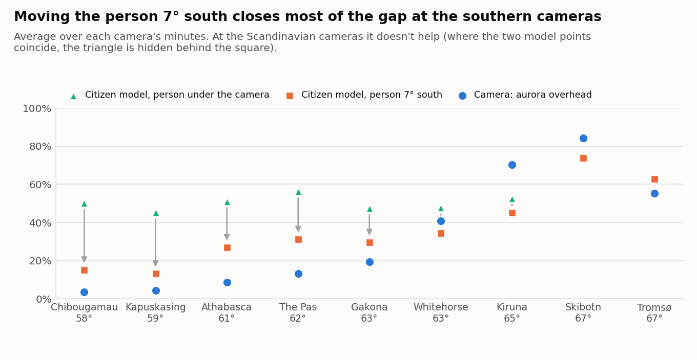

# Two models, two kinds of eyes

## Before predictions come the assumptions

"Aurora sighted" means something different to a person than to a camera. An
all-sky camera watches every dark minute and labels each one aurora or no aurora,
so its record tells you what fraction of all minutes had aurora. A citizen report
comes from someone who chose to go out, usually because they already expected to
see something. The physics behind the aurora is the same for both (geomagnetic
activity, a dark sky, clear weather), but the samples are very different. Reports
cluster where people live and where aurora chasers gather, so a model trained on
them could have learned *where people report from* rather than *when and where
aurora happens*.

I wanted to tell those two apart. Cameras sit in fixed places and don't care
about population or hype, which makes them a good test. There are really two
questions here, and they are worth keeping separate.

The first is about **ranking**. On ordinary minutes that nobody chose, does the
citizen model still give the aurora minutes higher numbers than the quiet ones?
If it had only learned reporting habits, it would fail this test.

The second is about **level**. If a camera records aurora 30% of the time, should
the citizen model say 30%? Not necessarily, and getting the level right isn't
needed to show the model learned physics. Both kinds of label make mistakes.
People miss faint aurora or mistake other glows for it; quite a few "seen"
reports were made in daylight, or at low magnetic latitudes on quiet nights. Cameras slip too.
Some started calling nearly every minute "aurora" after a few years. Cameras also disagree with each other: Tromsø and
Skibotn, only about 65 km apart, give different levels. A correction tuned to a
handful of camera sites can't be trusted everywhere, and this project is meant
to work at any location.

The answer to the first question is yes, as shown below. I also ran the check the
other way round: a model trained only on cameras, which never saw a single report,
predicts citizen reports nearly as well as the citizen model does. Both results
point to physics. For the second question, the calibrated
notebooks show a **range** across the cameras next to Model 1's number instead of
one corrected value.

## The two models

**Model 1, the citizen model (deployed).** An Explainable Boosting Machine (EBM) trained on about 22,000
Aurorasaurus reports, people saying "I saw it" or "I didn't". It answers *will a person here see aurora?*
Inputs and details are in [`MODEL.md`](MODEL.md).

**The camera model (included for reference).** It learns only from all-sky
cameras, where a machine labels each clear, dark, moon-free minute as aurora or
no aurora. I used 9 cameras with trustworthy labels: six THEMIS cameras in Canada
and Alaska, plus Tromsø, Kiruna and Skibotn in Scandinavia, all between 58° and
67° magnetic latitude. Its inputs are magnetic latitude, Kp, Bz, solar wind
speed, Ap and distance from the oval, and it is a plain logistic regression with
one weight per input. It answers *is aurora overhead at this camera?* The
model, the camera data and the checks behind points 1-3 below are in
`camera_model.ipynb`; the camera-based range, point 4 and the Svalbard result
are in `camera_calibration.ipynb`.

## What each model is good for

- **Truth it learns.** Model 1: what people report. Camera model: what a machine detects overhead.

- **Darkness, moon, cloud.** Model 1: built in. Camera model: not included; trained only on dark, clear,
  moon-free minutes.

- **Where it's trustworthy.** Model 1: northern hemisphere, up to ~72° magnetic latitude. Camera model:
  observers at ~51-60° (the cameras cover 58-67°).

- **Ranks citizen reports.** Model 1: 83%. Camera model: 80%.

- **Used live.** Model 1: yes. Camera model: no, included for reference.

## What each achieved

**1. Model 1 works on minutes nobody chose to report.** On the 9 cameras it
ranks aurora minutes above quiet ones 70-87% of the time (median 79%), compared
with 83% on citizen reports. Each of those scores comes from a single fixed
camera, so the model can only be using space weather. The exception is the polar cap:
above about 72° (Svalbard) it manages only 55%, close to a coin flip, so
predictions there are flagged "unreliable".

**2. The camera model predicts what people see without ever having seen a
citizen report.** It scores 80% on citizen reports, against 83% for Model 1.

**3. People see aurora that is overhead further north.** A camera only sees
aurora directly above it; a person also sees it low on the northern horizon. When I
compared Model 1's chance at each latitude with how often cameras record aurora
overhead, the two lined up best for a camera about 7° (roughly 800 km) further
north. For example, at Kp 4 Model 1 gives a person at 56° mlat about a 65% chance.
Cameras near 58° record aurora overhead in only 7-10% of such minutes, but
cameras at 62-63° record it in 54-77%.

<picture>
  <source media="(prefers-color-scheme: dark)" srcset="figures/shift_by_camera_dark.png">
  
</picture>

How to read it: for each camera, the blue circle is how often the camera saw aurora overhead, the green
triangle is Model 1 for a person standing under the camera, and the orange square is Model 1 for a person 7°
south. Without the shift, Model 1 overpredicts at every camera from 58° to 63° (46-56% against 4-41%). Moving
the person 7° south pulls the squares toward the circles: the average gap halves (0.27 → 0.13) and Model 1
follows the cameras' pattern more closely (correlation across the nine cameras 0.72 → 0.91). It doesn't close
the gap: the squares still sit above the southern cameras and below Kiruna and Skibotn.

**4. There is no single corrected percentage.** When a correction is fitted on
eight cameras and tested on the ninth, none does meaningfully better than the raw model on average.
So Model 1 is left unchanged, and the calibrated notebooks show a range instead: the chance a camera
would see aurora somewhere in your sky, roughly an upper bound for the eye.

## Bottom line

Model 1 stays as the prediction. People and cameras are two independent sources
of labels, and they agree on the physics. To be conservative, I also show a
camera-backed probability range next to Model 1's number, for observers at
about 51-60° magnetic latitude, where the cameras give support. It replaces a
single number that could look more precise than it is, and works roughly as an
upper limit on what a human observer will see.
