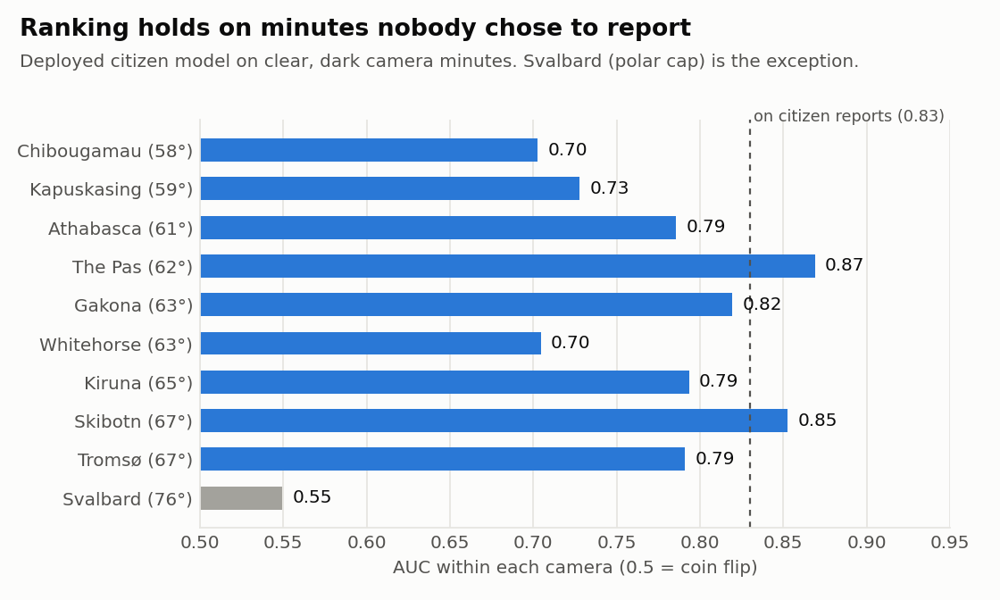
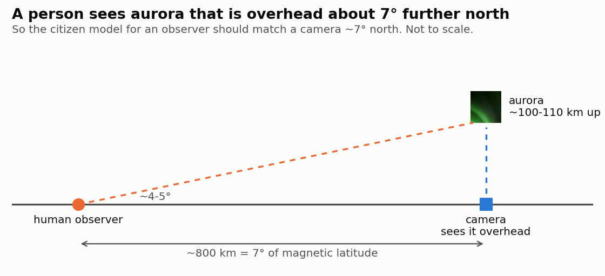
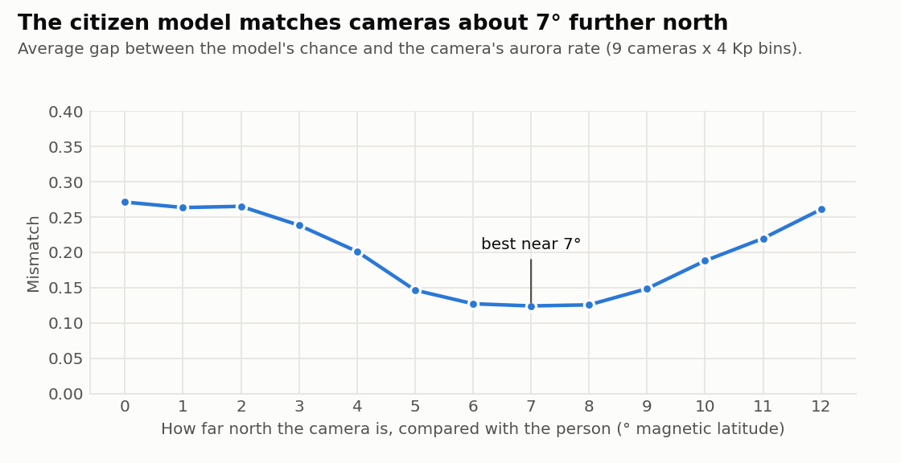
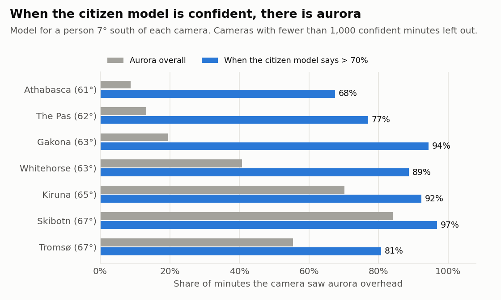

# Aurora Visibility Prediction

Live chance of seeing aurora at any location, from real-time [NOAA SWPC](https://services.swpc.noaa.gov/products/noaa-planetary-k-index.json)
space weather and live cloud cover. Trained on ~22,000 Aurorasaurus citizen-science sightings (2014-2025,
[data](https://zenodo.org/records/16783265)) merged with historical geomagnetic ([OMNI2](https://spdf.gsfc.nasa.gov/pub/data/omni/low_res_omni/))
and weather data, and checked against all-sky cameras. A continuation of
[summer26-aurora-visibility-predictions](https://github.com/Erdos-Projects/summer26-aurora-visibility-predictions).
Forecasts at a 6-36 hour horizon will be available soon.

Most aurora apps build on NOAA's [OVATION](https://www.swpc.noaa.gov/products/aurora-30-minute-forecast)
forecast, which gives the chance of aurora overhead from satellite measurements, and then turn it into a
viewing chance with rules of thumb such as NOAA's view line or a Kp table. This model instead learns the
viewing chance directly from what people reported seeing, including aurora low on their horizon, and is
checked against all-sky cameras.

**Try it** (runs in the browser via [Binder](https://mybinder.org); first launch takes a few minutes, then Run > Run All Cells):

- [](https://mybinder.org/v2/gh/shibasisr/aurora-visibility-live-predictions/main?filepath=aurora_lookup_calibrated.ipynb) location lookup with live weather (start here)
- [](https://mybinder.org/v2/gh/shibasisr/aurora-visibility-live-predictions/main?filepath=aurora_globe_calibrated.ipynb) globe, clear sky

Both show the model's chance and, next to it, a camera-based range ([`MODEL.md`](MODEL.md)).

## At a glance

**The question.** People report aurora when they already expect it, and from where they live. Did the model
learn aurora physics, or reporting habits? All-sky cameras answer this: they watch every dark minute from
fixed sites. I scored the model on ~740,000 clear, dark minutes from 9 cameras in Canada, Alaska and
Scandinavia, plus Svalbard.

**1. It ranks ordinary minutes almost as well as reports** (AUC 0.70-0.87 per camera against 0.83 on
reports). Inside the polar cap (Svalbard) it fails, so predictions above ~72° are flagged unreliable.

<picture>
  <source media="(prefers-color-scheme: dark)" srcset="figures/auc_by_camera_dark.png">
  
</picture>

**2. People see aurora that is overhead about 7° further north**, low on their horizon.

<picture>
  <source media="(prefers-color-scheme: dark)" srcset="figures/horizon_sketch_dark.png">
  
</picture>
<sub><sub>Photo: BLM Alaska, public domain (<a href="https://commons.wikimedia.org/wiki/File:Northern_Lights_2023-03_%2852707330654%29.jpg">commons.wikimedia.org</a>). Height: THEMIS maps aurora at 110 km (<a href="https://themis.igpp.ucla.edu/nuggets/nuggets_2021/Gabrielse_21/Gabrielse_21.html">themis.igpp.ucla.edu</a>).</sub></sub>

The data agree: the gap between the model and the cameras is smallest for a camera about 7° north.

<picture>
  <source media="(prefers-color-scheme: dark)" srcset="figures/shift_error_dark.png">
  
</picture>

**3. When it says more than 70%, there is aurora** 68-97% of the time, for a camera about 7° north
(cameras at 61-67°; further south it is rarely this confident).

<picture>
  <source media="(prefers-color-scheme: dark)" srcset="figures/precision_70_dark.png">
  
</picture>

A model trained only on cameras predicts citizen reports nearly as well (AUC 0.80 vs 0.83), so two independent
sources agree on the physics. Full write-up: [`CAMERA_VALIDATION.md`](CAMERA_VALIDATION.md).

**A model learned from citizen reports holds up against both the cameras and OVATION.** OVATION works
independently, from satellite counts of the charged particles that make aurora. Against OVATION runs archived by
[NASA CCMC](https://iswa.ccmc.gsfc.nasa.gov/iswa_data_tree/model/ionosphere/ovation_prime/) (the model behind most
aurora apps), it ranks the same camera minutes better (median AUC 0.80 vs 0.72) and is right more often when
confident (92% vs 71%). This is unfair to OVATION: its runs had only real-time solar-wind inputs (not Kp or other indices directly), which are noisier,
while this model was scored with the final, cleaned solar-wind and Kp data available in hindsight. The gap could be
entirely due to that ([`ovation_comparison.ipynb`](ovation_comparison.ipynb)).

## What's here

- `predict_core.py` — `predict_aurora_probability(lat, lon)`: live inputs in, probability out.
- `aurora_lookup.ipynb`, `aurora_globe.ipynb` — location lookup and globe; `*_calibrated.ipynb` add the
  camera-based range (`camera_calibration.py`, `predict_calibrated.py`).
- `aurora_final_deployment.ipynb` — trains the model (`aurora_ebm_model_final_deployment.joblib`).
- `camera_model.ipynb`, `camera_calibration.ipynb` — the camera checks and the calibration fit;
  `make_readme_figures.py` draws the figures above.
- `ovation_comparison.ipynb` — Model 1 against archived OVATION runs (`ovation_camera_minutes.csv.gz`, rebuilt
  by `fetch_ovation_ccmc.py`).
- [`MODEL.md`](MODEL.md) — the model, the calibration and known limitations.

## Setup

```bash
python3 -m venv venv
source venv/bin/activate
pip install -r requirements.txt
jupyter notebook
```

Run `aurora_lookup.ipynb` or `aurora_globe.ipynb` directly — both load the saved model, no retraining
needed. To retrain from scratch, run `aurora_final_deployment.ipynb`.

## Limitations, in short

- Above ~72° magnetic latitude (polar cap) predictions are unreliable.
- At high latitude on quiet nights the model barely responds to Kp; the citizen data lost that structure.
- Southern-hemisphere predictions are unreliable (2.9% of training data).
- Cloud cover is learned only weakly: most reports come from clear nights, and the historical cloud value is a
  coarse hourly estimate. The lookup shows live cloud separately; check it before going out.

Details in [`MODEL.md`](MODEL.md).
